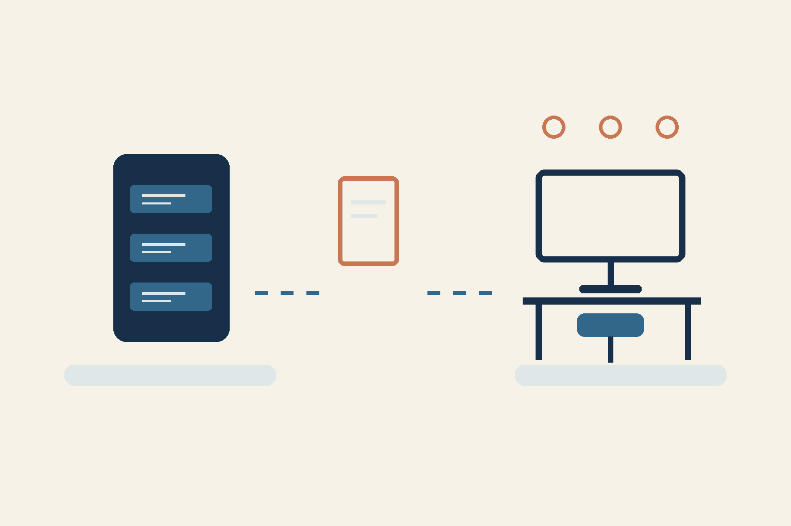

# The server has moved — can the team get back to work?

*AI-assisted conceptual diagram, not a screenshot of a running system or evidence of restoration.*

This is my first experience migrating a server. It has required considerable time. For a business owner, the practical question is whether the team can do its work again.

I would choose one important work journey and assess the result through it. For example: an employee signs in, finds a required record and performs an authorized operation. This is an example of a future check.

## Three questions after the move

- Data: is the required record available?
- Access: can the right role work with it?
- Operation: can the action reach its expected outcome?

I would name the person responsible for accepting that journey in advance. A successful sign-in alone does not establish data availability or a completed operation.

## What remains open

My account describes a first migration requiring considerable time. A saved coordinator report says restoration and checks were still incomplete. As this article is prepared on 9 November, I have no fresh application check: current readiness, full restoration and business acceptance are unconfirmed. The original disruption's cause, exact event date, duration and savings are not established here.

A practical step for the next move: write down one journey, its expected outcome and who will accept it. This is a proposed criterion, not a report of a completed test.

Which journey would you check first?

RRA

Prepared by an AI agent from the owner's account and a sanitized saved report.
