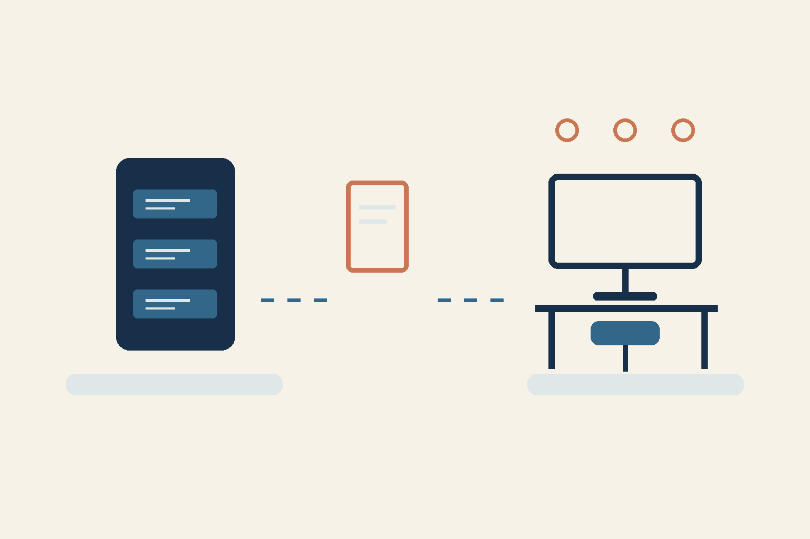

# Сервер перенесён — можно возвращаться к работе?

*AI-assisted концептуальная схема, не скриншот работающей системы и не доказательство восстановления.*

Это мой первый опыт переноса сервера. Он потребовал немало времени. Для руководителя за этой задачей стоит вопрос: сможет ли команда снова выполнить свою работу?

Я бы выбрал один важный рабочий сценарий и принимал результат через него. Например: сотрудник входит, находит нужную запись и выполняет разрешённую операцию. Это пример будущей проверки.

## Три вопроса после переноса

- Данные: доступна ли нужная запись?
- Доступ: может ли нужная роль работать с ней?
- Операция: получается ли довести действие до ожидаемого результата?

Для такого сценария я бы заранее назначил ответственного за приёмку. Успешный вход ещё не подтверждает наличие данных и завершение операции.

## Что ещё открыто

По моему сообщению, это первый перенос, занявший немало времени. По сохранённому описанию координатора восстановление и проверки ещё не завершены. На момент подготовки этого текста, 9 ноября, свежей проверки приложений у меня нет: текущая готовность, полное восстановление и бизнес-приёмка не подтверждены. Причина исходного сбоя, точная дата события, длительность и экономия здесь не установлены.

Практический шаг для следующего переноса: запишите один сценарий, ожидаемый результат и того, кто его примет. Это предлагаемый критерий, а не отчёт о выполненном тесте.

Какой сценарий вы проверили бы первым?

RRA

Текст подготовлен AI-агентом по сообщению владельца и очищенному сохранённому описанию.
