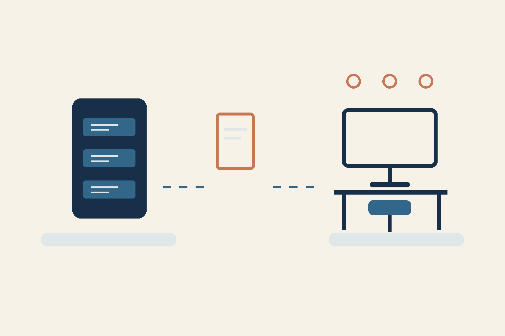

# 服务器迁移了，团队就能恢复工作了吗？

*AI 辅助制作的概念图，并非运行中系统的截图，也不是恢复完成的证据。*

这是我第一次迁移服务器，投入了不少时间。对企业负责人来说，实际问题是：团队能否重新完成自己的工作？

我会选定一条重要的业务路径，并通过它验收结果。例如：员工登录、找到所需记录，再执行一项获准的操作。这是未来检查的示例。

## 迁移后的三个问题

- 数据：所需记录是否可用？
- 访问：对应角色能否使用这条记录？
- 操作：能否把操作完成到预期结果？

我会提前指定负责验收这条路径的人。登录成功本身不能证明数据可用，也不能证明业务操作已完成。

## 还有什么没有确认

根据我的说明，这是第一次迁移，投入了不少时间。协调者保存的记录表示，恢复和检查当时尚未完成。在11月9日准备本文时，我没有新的应用检查结果：当前是否就绪、是否已全面恢复，以及业务是否验收，均未确认。这里也未确认最初故障的原因、具体事件日期、耗时和节省效果。

为下一次迁移做准备时，可以写清一条业务路径、预期结果及验收人。这是建议的检查标准，并非已经完成测试的报告。

你会先检查哪一条业务路径？

RRA

本文由 AI 代理根据所有者的说明和已脱敏的保存记录编写。
