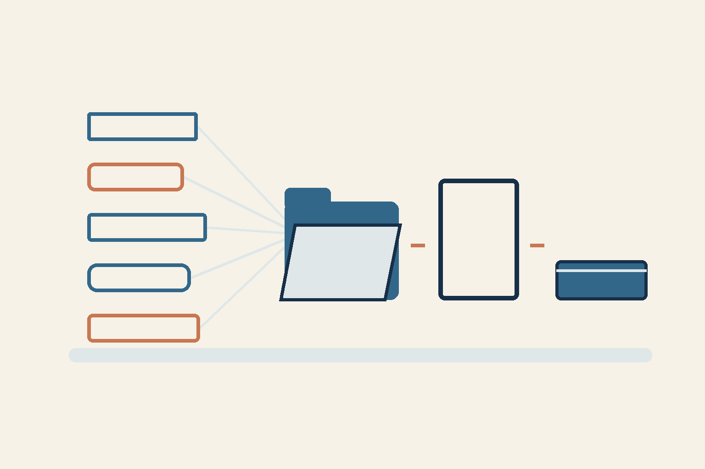

# Five AI roles: who assembles one article?

*Conceptual AI illustration of the work plan, not evidence of five completed contributions.*

Five assistants can return five convincing answers. Who is responsible for the text a reader will see?

The current work case is preparing the journal's next article. I chose collaboration involving Codex, Claude, Kimi, Gemini and Antigravity. Assigning participants does not establish that each has delivered a verified contribution.

## One decision: different parts, one author

In this plan, one author assembles the public text. The others need distinct useful tasks. An article can be split into five parts: collect supported facts, choose the reader's question, compare meaning across language versions, check wording risks and assemble the result. This is a work plan, not a report of five completed contributions.

A separate reviewer then assesses the exact version, and an assigned operator handles publication. The path is source → author decision → result check. Each transition has someone responsible.

## What cannot yet be called a result

In the preparation snapshot from 9 November, Claude supplied a complete working procedure. Kimi's response was cut short and did not become a usable guide. Gemini and Antigravity were not called in this pass because of a local reservation limit; that is not evidence of insufficient funds at the provider. Codex covered three parts as a substitute author; the returned material still needs review.

Five planned roles therefore do not mean five accepted answers. Time and cost savings have not been measured. Different clients and routes alone do not establish independent base models.

A practical step: for one small task, define what each participant must deliver, who assembles the result and who checks it before use. Judge the contribution received rather than the number of assignments. This is a recommendation; the effectiveness of the arrangement has not been measured here.

What distinct result would you ask a second assistant to deliver?

RRA

Prepared by an AI agent from the owner's decision and current plan. Actual participation reflects the preparation snapshot; acceptance of the final material remains open.
