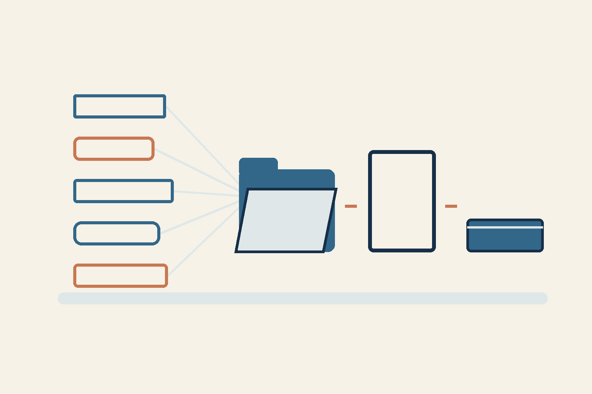

# Пять AI-ролей: кто собирает один материал?

*Концептуальная AI-иллюстрация плана работы, не доказательство завершения пяти вкладов.*

Пять помощников могут прислать пять убедительных ответов. Кто отвечает за текст, который увидит читатель?

Сейчас рабочий кейс — подготовка следующего материала дневника. Я выбрал совместную работу Codex, Claude, Kimi, Gemini и Antigravity. Но само назначение участников ещё не означает, что каждый внёс проверенный вклад.

## Одно решение: разные части, один автор

В этом плане один автор собирает публичный текст. Остальным нужны разные полезные задачи. Для материала можно разделить работу на пять частей: собрать подтверждённые факты, выбрать вопрос читателя, сверить смысл языковых версий, проверить риски формулировок и собрать итог. Это схема работы, а не отчёт о пяти завершённых вкладах.

Затем отдельный проверяющий оценивает точную версию, а публикацией занимается назначенный исполнитель. Получается путь: источник → решение автора → проверка результата. У каждого перехода есть ответственный.

## Что пока нельзя объявить результатом

В снимке подготовки от 9 ноября Claude дал полный порядок работы. Ответ Kimi оборвался и не стал готовым руководством. Gemini и Antigravity в этом проходе не вызывались из-за ограничения локального резерва; это не доказательство отсутствия денег у провайдера. Три части закрыл Codex как заменяющий исполнитель; полученные материалы ещё нужно проверить.

Поэтому пять запланированных ролей не означают пять принятых ответов. Экономия времени и денег не измерена. Разные клиенты и маршруты сами по себе не доказывают независимость базовых моделей.

Практический шаг: для одной небольшой задачи запишите, что именно должен дать каждый участник, кто собирает результат и кто проверяет его перед использованием. Оценивать стоит полученный вклад, а не число назначений. Это рекомендация; эффективность такой схемы здесь не измерена.

Какой отдельный результат вы поручили бы второму помощнику?

RRA

Текст подготовлен AI-агентом по решению владельца и текущему плану. Фактическое участие описано по снимку подготовки; приёмка итогового материала ещё открыта.
