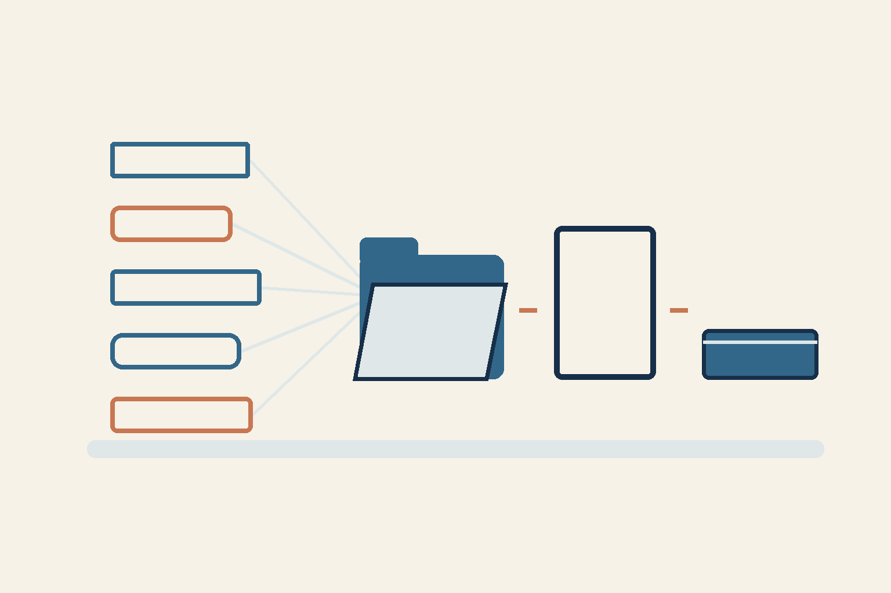

# 五个 AI 角色：谁来整合一篇文章？

*展示工作计划的 AI 概念插图，并非五方贡献均已完成的证据。*

五个助手可以交来五份看似有说服力的答案。但谁对读者最终看到的文字负责？

当前的工作案例是准备日记的下一篇文章。我选择让 Codex、Claude、Kimi、Gemini 和 Antigravity 协作。不过，安排了参与者，并不代表每一方都已交付经过核验的贡献。

## 一个决定：分工不同，由一位作者整合

在这个计划中，由一位作者整合公开文本，其他参与者承担不同且有用的任务。一篇文章可以分成五个部分：整理有依据的事实、选择读者的问题、核对不同语言版本的含义、检查措辞风险，以及整合结果。这是工作安排，并非五份贡献都已完成的报告。

随后，由单独的审阅者检查确切版本，再由指定执行者负责发布。流程是：来源 → 作者决策 → 结果检查。每一步交接都有负责人。

## 还有什么不能称为结果

根据11月9日的准备记录，Claude 交付了完整的工作流程。Kimi 的回答被截断，没有形成可用的指南。本轮由于本地预留额度限制，没有调用 Gemini 和 Antigravity；这并不证明供应商账户余额不足。Codex 作为替代执行者补上了三部分内容，收到的材料仍需审阅。

因此，计划中的五种角色并不等于五份已被接受的答案。目前没有测量时间或费用节省效果。不同的客户端和访问路径，本身也不能证明基础模型相互独立。

一个实际步骤：针对一项小任务，写清每位参与者要交付什么、谁负责整合，以及谁在使用前检查。应评估收到的实际贡献，而不是分配了多少任务。这是建议；本文没有测量这种安排的效果。

你会请第二个助手交付哪一项不同的成果？

RRA

本文由 AI 代理依据所有者的决定和当前计划编写，实际参与情况依据准备记录描述，最终材料仍待验收。
